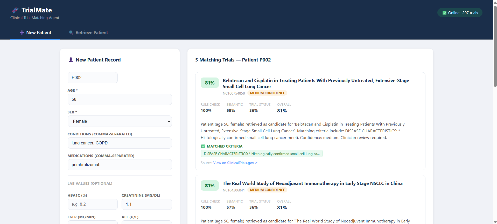

[](https://github.com/megradhikan/trialmate/actions/workflows/ci.yml)

# 🧬 TrialMate — Clinical Trial Matching Agent

Matches a patient record (age, sex, conditions, medications, labs) to relevant trials from ClinicalTrials.gov. It combines **semantic retrieval** over eligibility clauses, a **deterministic rule engine** that hard-excludes trials the patient clearly fails (age, sex, lab thresholds), and **explanations that cite the specific criteria** behind each match.

> ⚠️ **Prototype. Synthetic data only. Not for clinical use.**



## Results at a glance

Measured on 297 real ClinicalTrials.gov trials (diabetes, hypertension, lung cancer) and 51 generated patients. Every number below is reproducible with the commands in [Reproducing results](#reproducing-results).

| Ranking mode | P@5 | nDCG@10 (95% CI) | MRR |
|---|---|---|---|
| Random | 0.22 | 0.23 [0.18, 0.28] | 0.38 |
| Rules only | 0.27 | 0.27 [0.23, 0.32] | 0.47 |
| Semantic only | 0.42 | 0.40 [0.32, 0.48] | 0.57 |
| **Hybrid (rules + semantic + trial status)** | **0.45** | **0.46 [0.38, 0.53]** | **0.65** |

Embedding model `all-MiniLM-L6-v2`. Relevance = the trial lists the patient's condition **and** the patient's age and sex fit the registry's structured eligibility fields (about 71 relevant trials per patient). A random ranking already gets P@5 ≈ 0.22, so judge gains against that, not against zero.

**What this does and does not show**

- ✅ Semantic retrieval roughly doubles precision over random, and the hybrid is the best mode on every metric.
- ⚠️ The gap between *hybrid* and *semantic-only* is **not statistically significant** at this sample size (the confidence intervals overlap). The rule engine's value is mostly *safety*: vetoing trials whose age/sex/lab criteria a patient clearly fails, which these topical labels only weakly reward.
- ⚠️ These are **silver labels** (condition + age + sex from structured registry fields). They do not cover labs, medications or exclusion criteria, so this is not clinical-grade validation.

### Findings that changed the design

Building the evaluation honestly surfaced several things the first version got wrong. They are fixed, and they are the most useful part of this project to talk through:

| Finding | Fix |
|---|---|
| The age parser read *"18 years or older"* as `min=18` **and** `max=18`, hard-excluding every adult from such trials | Rewrote age parsing (direction-aware, context-gated) with regression tests |
| The "learned reranker" was trained on feature values *sampled from label-dependent ranges*, so its coefficients were an artifact | Now fit on real pipeline features and evaluated with patient-level cross-validation. It does **not** beat the fixed weights, so it stays off by default |
| The domain-specific BioBERT embedding was assumed to beat MiniLM | Measured: no gain here (hybrid nDCG@10 0.46 for MiniLM vs 0.33 for BioBERT; semantic-only is a tie), and MiniLM is ~5× smaller. MiniLM is the default; BioBERT remains selectable |
| The hand-written author labels (≈2 relevant trials per patient out of 297) are incomplete, so absolute precision on them is near zero for every method | Kept as a secondary check; the headline uses registry labels. Both result files are committed |
| Free-text annotator notes were being passed to the retriever, leaking the answer | Patients are built from structured fields only |

Ablation across both embedding models and both label sets: [`evaluation/results_*.json`](evaluation).

## Latency

Retrieval + rule checks + scoring + rule-based rationale; 297 trials, `all-MiniLM-L6-v2`, Apple Silicon CPU, single process, sequential queries, after warm-up. **LLM time is excluded** (it depends on the provider).

| p50 | p95 | p99 | mean |
|---|---|---|---|
| 68 ms | 76 ms | 76 ms | 68 ms |

## How it works

```
Patient record
   │
   ▼
Embed patient summary ──► FAISS (clause-level index) ──► candidate trials
                                                              │
                         ┌────────────────────────────────────┤
                         ▼                                    ▼
                  Rule engine                         Semantic score
          (age / sex / lab thresholds;              (mean similarity of the
           hard violation ⇒ score 0)                 trial's inclusion clauses)
                         │                                    │
                         └──────────────┬─────────────────────┘
                                        ▼
        score = 0.6·rule + 0.3·semantic + 0.1·trial status/phase
                                        ▼
                 Explanation (LLM, or rule-based fallback) citing matched/violated clauses
```

- **Clause-level retrieval.** Eligibility text is split into individual clauses (age, labs, history, …) so a match can cite *which* criterion fit.
- **Rule engine** ([`matching/clause_normalizer.py`](matching/clause_normalizer.py)): regex normalization of age, sex and lab criteria into constraints, with pass / fail / uncertain verdicts. Uncertain is never treated as a failure.
- **Provider-agnostic LLM layer**: Anthropic, OpenAI, local Ollama, or `mock` (rule-based rationales, no key needed). Responses are disk-cached.
- **Optional learned reranker**: logistic regression over the three features, with JSON-persisted weights. Train with `python -m evaluation.run_ablation --train-reranker`.

## Quickstart

No API key required (defaults to the `mock` LLM provider, which falls back to rule-based rationales).

```bash
pip install -r requirements.txt        # Python 3.10–3.11
uvicorn api.main:app --port 8000
# open http://localhost:8000  (the demo UI is served at "/")
```

Or with Docker (the image pre-builds the index; `render.yaml` deploys it as a Render web service):

```bash
docker build -t trialmate . && docker run -p 8000:8000 trialmate
```

For LLM-written explanations set `LLM_PROVIDER=anthropic` (or `openai`) plus the API key; see [`.env.example`](.env.example). The FAISS index is built automatically on first start.

### API

| Method | Endpoint | Description |
|---|---|---|
| `POST` | `/patients` | Upload a patient record |
| `GET` | `/patients/{id}/matches?top_k=5` | Ranked matches with rationale, matched and violated clauses |
| `POST` | `/patients/batch` | Match many patients concurrently (max 100) |
| `GET` | `/trials/{nct_id}` | Trial metadata and parsed clauses |
| `GET` | `/health` | Status and trial count |

Interactive docs at `/docs`.

## Reproducing results

```bash
python -m evaluation.build_registry_labels                       # silver labels from registry fields
python -m evaluation.run_ablation --model all-MiniLM-L6-v2       # headline table (writes evaluation/results_*.json)
python -m evaluation.run_ablation --model pritamdeka/BioBERT-mnli-snli-scinli-scitail-mednli-stsb
python -m evaluation.run_ablation --labels author                # incomplete author-written labels
python -m scripts.benchmark --n 50                               # latency
pytest tests/ -v                                                 # incl. an end-to-end ranking regression
```

## Limitations and next steps

- **Labels are silver, not clinical.** Next step: clinician- or LLM-adjudicated labels covering labs, medications and exclusions, then report inter-annotator agreement.
- **Small scale**: 297 trials, three conditions, 51 evaluated patients; no claims beyond the intervals shown.
- **Rule coverage is narrow**: age, sex and a few labs. Medication, prior-therapy, stage and ECOG criteria are retrieved semantically but not verified.
- **Semantic score is a mean over clause similarities**; max-pooling or a cross-encoder rerank are the obvious experiments.
- **Clause splitting leaves markdown artefacts** (e.g. a leading `*`) in some clauses.
- Synthetic patients only; see [`docs/SECURITY_ETHICS.md`](docs/SECURITY_ETHICS.md) and [`docs/DESIGN.md`](docs/DESIGN.md).

## Project structure

```
api/          FastAPI app, Pydantic schemas, serves the UI at "/"
matching/     embedder + FAISS index, rule engine (clause_normalizer), scorer + pipeline
ingestion/    ClinicalTrials.gov parser and clause splitter
llm/          provider-agnostic client, prompts, explainer
evaluation/   ablation runner, registry-label builder, committed results
scripts/      patient generator, trial merger, latency benchmark
tests/        rules, scoring, reranker, API, end-to-end regression
ui/           single-file web UI
```
